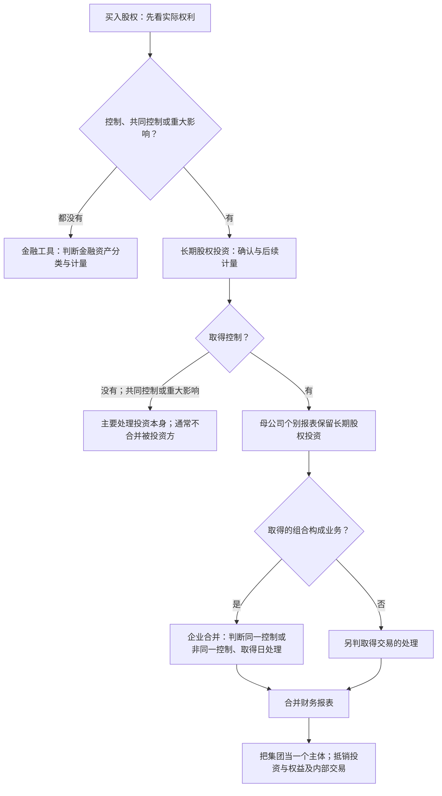

# NOESIS｜2027 CPA 备考执行计划

## 9月25日高级地形预览｜实际学习材料

**总问题：买入另一家企业的股权后，先判断取得了什么权利，再决定投资如何记账，以及报表要呈现哪一个主体。**持股比例只是线索，题目给出的表决权、决策安排等事实决定控制、共同控制或重大影响。下图是普通企业的基本路径；投资性主体等特殊情况留到正式单元处理。范围按[中注协2026会计大纲](https://www.cicpa.org.cn/xxfb/tzgg/202603/W020260304555799366109.pdf)作`[2026 临时基线｜待 2027 大纲复核]`。投资准则的分界依据[财政部实施问答](https://kjs.mof.gov.cn/zt/kjzzss/sswd/jrgjzzss/202103/t20210302_3664211.htm)。

| 模块 | 此章回答的问题 | 向下一章提供什么 |
|---|---|---|
| 金融工具 | 这项权利是何种金融资产，初始和以后如何计量？无控制、共同控制、重大影响的普通股权投资通常进入这一路。 | 理解金融资产、公允价值与计量变化，也为以后追加或处置股权时的方法转换打底。 |
| 长期股权投资 | 我与被投资方的关系是共同控制、重大影响还是控制？投资在**本企业个别报表**如何确认和继续计量？ | 识别联营、合营、子公司；确定何时进入控制与集团报告的问题。 |
| 企业合并 | 取得控制时，取得的组合是否构成业务？若构成，原本是否受同一最终控制方控制、取得日如何处理？ | 给合并报表提供取得日的起点和计量基础；不是每次买股权都构成企业合并。 |
| 合并财务报表 | 哪些主体纳入集团？把母子公司报表放在一起后，哪些内部关系、内部交易需要抵销？ | 产出集团口径的资产、负债、利润与现金流；子公司不是只按持股比例并入各项资产负债。 |

**贯穿例子。**甲购买乙的少量股份，题设明确甲无决策影响力：先研究金融工具。后来甲取得参与乙重要经营决策的权利但仍不能控制：转入长期股权投资的问题。再后来甲取得控制且乙构成业务：先判断企业合并类型和取得日处理，随后编制合并报表；甲的个别报表仍有对乙的长期股权投资。最后，若甲向乙赊销商品，甲、乙各自仍记自己的销售或购货；集团报表要消除集团内部的收入、应收应付和未对外售出商品中的内部利润。这里的“抵销”是在编制合并报表时从集团视角调整，不是把两家公司的日常账簿抹掉。[财政部合并报表准则](https://www.mof.gov.cn/gkml/caizhengwengao/wg2014/wg201405/201412/t20141217_1168564.htm)规定了合并范围、投资与权益抵销以及内部交易抵销。

**75分钟的实际产出：**用15分钟重画“权利→准则→报表”分叉；20分钟说清四章各解决哪个问题；20分钟沿上述例子口头走完三次关系变化；最后20分钟列出待正式学习的前置项：控制/共同控制/重大影响的判断，成本法与权益法，业务及同一控制判断，取得日计量，合并范围与内部交易抵销。这是地形预览，暂不要求精确分录、商誉计算，也不记M2/M3。

## 2026-09-28更新｜正式学习安排

9月25日的高级地形图是已完成的预览。原9月27日单科启动、10月会计单线、以净学习小时作为报考闸门的安排，已由用户在2026-09-28重新确定，后续执行以[[08-会计税法四个月并行计划]]为准。

- 2026-09-29—09-30：两次轻量启动，先处理会计跨表错项，再建立会计与税法的问题对照，不提前负担完整新章。
- 2026-10-01—2027-01-31：会计和税法同时备考，使用工作间隙完成小教学块、独立应用、到期复提和真题训练。10月7日复盘一周运行，10月31日复盘首月结果，随后按反馈滚动调整。
- 不把无法可靠估算的碎片化净学习时长当作强制指标；整卷和题组的可靠限时作答仍单独记录。
- 已下载的中注协备考助手往年部分真题在学习阶段就按已教范围使用，同时按题号保留未见题用于测评；见[[93-真题使用登记]]。
- 2027官方大纲发布前，范围暂依[中注协2026专业阶段大纲](https://www.cicpa.org.cn/xxfb/tzgg/202603/W020260304555799366109.pdf)，税法易变规则须逐次核源并待2027大纲复核。
