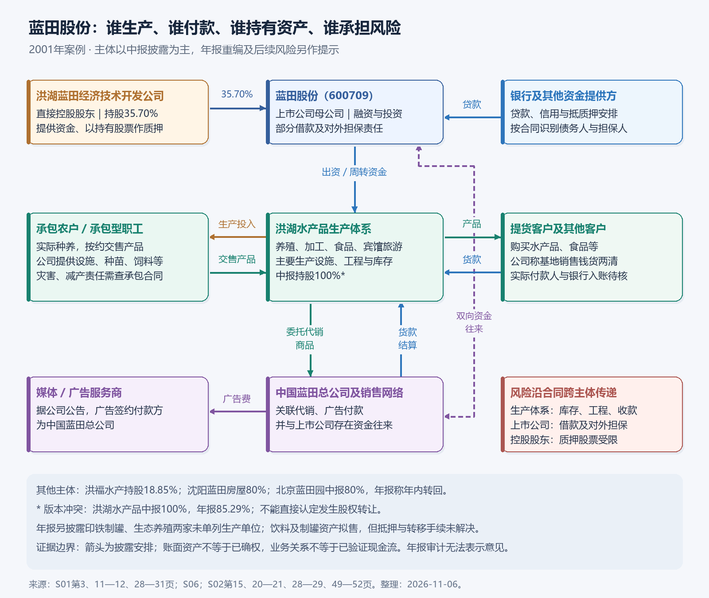
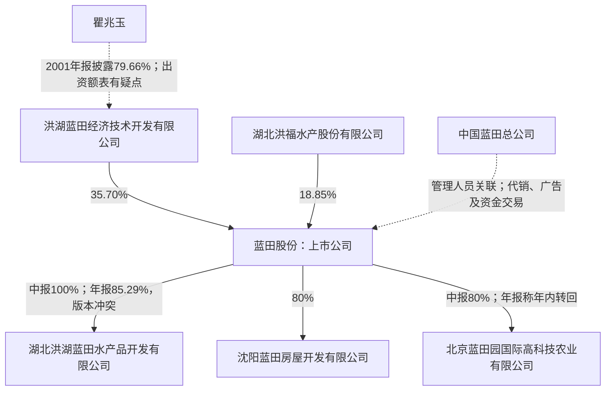
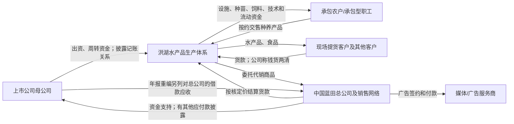

# 蓝田股份业务图：谁生产、谁付款、谁持有资产、谁承担风险

整理日期：2026-11-06。对象为原600709蓝田股份。主图采用**2001年中报的披露口径**，另列2001年报及截至其报出时披露的后续事项。年报于2002年4月披露，不能把其中的信息当作2001年中已经知道的事实。

本文区分“公司披露的安排”“审计师发现的证据缺口”“分析判断”。中报未经审计，年报审计师无法表示意见；以下数字和关系是有出处的披露记录，不代表已恢复一套经过验证的真实账务。所有S01/S02/S15页码均为各自原PDF物理页码，而非合订打印册页码。

## 一、先回答四个问题

| 问题 | 有来源的回答 | 尚不能确认的部分 |
|---|---|---|
| 谁生产？ | 洪湖水产品子公司及基地是农业和食品生产核心；承包农户/承包型职工直接种养。年报另披露印铁制罐、生态养殖两个此前未单列的生产单位。 | 农户完整名册、实际产量、具体交售记录、各法人之间每道加工工序的归属未取得。 |
| 谁付款？ | 基地提货客户向经营方付货款；代销商按核定价结算；中国蓝田总公司签广告合同并付广告费；上市公司融资、向子公司投入或提供周转款；集团各主体还存在借款、预收款及票据往来。 | 每笔现金究竟进入哪一个法人账户、代销终端客户真实付款人及最终资金去向，不能仅由合并报表确认。 |
| 谁持有资产？ | 生产设施、在建工程和库存主要列在上市公司合并范围，经营使用集中在洪湖水产品体系；上市公司母公司另持子公司股权。代销商保管的商品仍可能列为集团库存。 | 湖面/土地所有权与承包经营权、厂房设备的完整权属、商标权原件及已抵押资产处分条件存在缺口。账面有资产不等于产权已经核实。 |
| 谁承担风险？ | 生产体系面对产量、库存、收款与项目回收风险；中国蓝田承担其披露的广告付款及对上市公司资金支持风险；上市公司是部分借款的债务人、另对总公司借款提供担保；控股股东以所持上市公司股票质押；银行面对信用及抵质押物不足风险。 | 农户与企业如何分担疫病、洪灾、价格损失，要看承包合同；未取得完整合同，不能把这些损失一概判给某方。 |

依据：S01第3、11—12、24—25、28—31页；S06“经营情况”“其它”；S02第15、20—21、28—29、31—35、49—52页。

## 二、主体名册：股权关系与业务关系分开看

### 1. 上市公司、股东和控制线索

| 主体 | 身份及关系 | 在业务图中的角色 | 证据与边界 |
|---|---|---|---|
| **湖北蓝田股份有限公司** | 上市公司，代码600709；原名沈阳蓝田股份有限公司，2001年末更名为湖北江湖生态农业股份有限公司。 | 公开融资主体、母公司、部分贷款借款人、对子公司投入和提供周转资金、部分对外担保主体。 | S01第1、6—7、24—25页；S02第4、12、18—21、45—47、51—52页。合并报表中的“公司”不能一律理解为母公司自己在生产或自己收付款。 |
| **洪湖蓝田经济技术开发有限公司** | 直接控股股东，持股**35.70%**。 | 控股；向上市公司提供资金，也存在向上市公司借款的披露；以持有的上市公司股票为贷款作质押。 | S01第3、27—28、31页；S02第7、48—52页。质押物是其持有的股票，并非直接把上市公司的所有经营资产拿去抵押。 |
| **湖北洪福水产股份有限公司** | 第二大股东，持股**18.85%**；年报列示其股东包括国营渔场等。 | 股权投资者；其本身经营淡水养殖等业务。 | S01第3页；S02第7—8页。年报把它列在“控股股东情况”小节，但不能因此认定它与35.70%股东共同控制；年报称前十名股东之间无关联关系。 |
| **瞿兆玉** | 年报披露为第一大股东的控股股东，所列持股比例**79.66%**；中报记载其在上市公司任董事，同时任中国蓝田总公司法定代表人。 | 串联两个“蓝田”的关键管理人员与控制线索。 | S01第28页；S02第7、48—49页。第7页“1300万元”与注册资本16319万元及79.66%不相符，原PDF确实如此；本文只转述披露比例，不自行改写出资额，也不把该披露视为工商确证。 |
| **中国蓝田总公司** | 中报列为“不存在控制关系的关联方”，依据为管理人员兼职；年报列为“受同一关键管理人员控制”。 | 产品代销、广告签约付款、资金支持与资金往来、资产/股权买卖对手、部分贷款担保方及借款人。 | S01第28—31页；S06“其它”；S02第49—52页。**不能因为名称带“总公司”，就画成上市公司的直接母公司。**审计师对第一大股东的控股股东与这类关联方之间的关系未获法律文件，无法判断真实性，见S02第21页。 |

股权示意（比例为所引版本的披露，不含未验证的推测控制线）：

### 2. 子公司、生产单位与分支机构

| 主体 | 中报披露 | 年报/后续披露 | 业务、资产与风险位置 |
|---|---|---|---|
| **湖北洪湖蓝田水产品开发有限公司** | 持股100%，纳入合并；注册资本6800万元。 | 第28、48页列85.29%，且年初年末均为该比例。第18页仍称“全资”，形成内部不一致。 | 淡水养殖、农副产品加工销售、宾馆旅游；基地、种养加工设施及工程的主要经营体系。**100%与85.29%先记为版本冲突，未找到证据前不解释为真实转让。**S01第11—12、25页；S02第18、28、48页。 |
| **沈阳蓝田房屋开发有限公司** | 持股80%，纳入合并。 | 年报仍列80%。 | 房地产开发及商品房销售；对应库存商品房、预收购房款和交房义务。中报披露购房争议，年报还列母公司对其周转资金。S01第12、31页；S02第28、32、46页。 |
| **北京蓝田园国际高科技农业有限公司** | 持股80%，纳入合并，尚在筹建；2001年3月以2320万元向中国蓝田总公司收购。另20%股东为北京市京普物资有限责任公司。 | 年报正文称年内以同价转回中国蓝田，年末列为关联方而非子公司。年报第51页把购入月份写成10月，与中报及年报正文3月的说法冲突。 | 高科技农业示范园投资项目，不能把筹建期经营范围当成已经形成的产能。原收购方付款给中国蓝田总公司，不等于直接给项目公司增资。S01第4—5、12、18、32页；S02第12、18、49、51页。 |
| **洪湖蓝田印铁制罐有限公司** | 未在中报三家子公司表中单列。 | 年报首次解释：1996年设立，公司名义出资2600万元占86.67%，瞿定裕400万元占13.33%；公司称个人实际不享有股权，按100%经济权益作为水产品公司的附属生产单位合并。 | 空罐印铁、制造加工销售，支持饮料包装；还参与票据贴现融资。**名义股东、经济权益主张和实际记账单位不是同一概念。**S02第15、28—29、52页。 |
| **湖北洪湖生态养殖开发有限公司** | 未在中报三家子公司表中单列。 | 年报解释：水产品公司名义出资850万元占85%，肖纯林150万元占15%；公司称个人实际不享有股权，仍作水产品公司的附属生产单位合并。 | 畜禽、蔬菜、水生动植物养殖开发加工销售。个人出资由公司代付/代持的说法属于公司解释，未获完整工商及出资文件。S02第15、28—29页。 |
| **沈阳新北制药厂、沈阳莲花酒店等沈阳经营单位** | 原发起及经营单位，年报有药品销售、酒店工程等披露。 | 年报母公司仍有药品生产销售；新北商场披露为2000年注销。 | 不能看到单位名称就统一当成独立子公司；本次未取得逐家营业执照核实其法律形式。S01第6—7、17—18页；S02第34、47页。 |
| **承包农户/承包型职工** | S06说明公司提供设施、种苗、饲料、技术和流动资金，承包人按额定数量及单价交售产品，剩余部分公司按市价收购。 | 未取得逐户合同与名册。 | 直接劳动、种养和交售者；不因承包就成为子公司或股东。超产收益、灾害损失、投入回收及保底义务要查承包合同，不能臆定。 |

年报审计报告指出印铁制罐、生态养殖两家公司此前未披露，认为内部控制失效，不能确定类似情况是否披露完整（S02第20—21页）。因此上表是**现有材料能列出的主体**，不是已证明穷尽的集团法人名册。

### 3. 其余已点名关联方

| 披露名称 | 关系及已见往来 | 来源 |
|---|---|---|
| 沈阳蓝田木制品有限公司／年报“蓝田木制品” | 中报称属于中国蓝田总公司；年报称受同一关键管理人员控制。存在其他应收、其他应付款，名称缩略对应待工商进一步确认。 | S01第28、30页；S02第49—50页 |
| 沈阳新泉卫生用品有限公司 | 中报称属于中国蓝田总公司；年报列同一关键管理人员控制，有其他应付款。 | S01第28、31页；S02第49—50页 |
| 广州蓝田智业市场研究有限公司／公司 | 同上，有其他应付款。 | S01第28页；S02第49—50页 |
| 随州蓝田公司 | 中报称同一母公司；年报列同一关键管理人员控制，有其他应收款。 | S01第28、30页；S02第49—50页 |
| 随州肉联厂／随州肉联加工厂 | 中报称同一母公司；年报其他应收款表亦有列示。名称是否同一法人待核。 | S01第28页；S02第50页 |
| 沈阳洪湖蓝田经贸有限责任公司 | 中报称属于中国蓝田总公司，有其他应付款。 | S01第28、31页 |
| 湖南临湘蓝田药业有限公司／临湘蓝田药业公司 | 中报称属于中国蓝田总公司；年报列同一关键管理人员控制，有其他应付款。 | S01第28、31页；S02第49—50页 |
| 随州蓝田银杏茶生物制药厂 | 年报列同一关键管理人员控制，有其他应收款。 | S02第49—50页 |
| 深圳蓝田玉投资公司 | 年报列同一关键管理人员控制，有其他应收款2700万元。 | S02第31、46、49—50页 |
| 广州蓝田公司 | 年报列同一关键管理人员控制，有其他应收款。不能只凭名称与广州智业合并。 | S02第49—50页 |
| 广东蓝田农产品交易市场 | 年报列同一关键管理人员控制，有其他应收款。 | S02第49—50页 |
| 华田农产品交易公司 | 年报列同一关键管理人员控制，有其他应付款。 | S02第49—50页 |
| 广东华田公司 | 年报列同一关键管理人员控制，有其他应付款。不能只凭名称与上一家合并。 | S02第49—50页 |
| 北京蓝田园国际高科技农业有限公司 | 年中曾为子公司，年报称转回中国蓝田后列为同一关键管理人员控制关联方。 | S01第5、12页；S02第49—51页 |
| 中国蓝田总公司及所属各销售公司/分公司/办事处 | 代销、货款、预收款及借款网络。分公司、办事处不宜全部画成独立子公司；是否独立法人要查登记资料。 | S01第28—31页；S02第49—50页 |

S01第29—31页点名的销售网络包括：**北京、新疆、荆州、天津、青岛、大连、广州、深圳、宜昌、珠海、南京、成都、上海、郑州、哈尔滨、西安、本溪、长春、福州、长沙、南宁、石家庄、太原、沈阳、武汉、江西**，以及未明确地域的“经销处”“本溪市平山区蓝田产品经销部”。这些名称分别出现在代销商品或应收、预收、借款明细，不能理解成每一处都开展了同样的交易。

### 4. 有往来的其他主体，不自动归为关联方

| 主体 | 已披露角色 | 来源 |
|---|---|---|
| 基地现场提货客户、个体经营者及其他下游客户 | 购买水产品、食品等；完整客户名册与最终付款人未取得。 | S01第3页；S06“经营情况” |
| 瞿家湾村委会 | 年报列借款及代垫款项应收23,645,915.63元；另有较大其他经营现金支付。不能仅因此认定其为上市公司的控股股东或湖面资产所有者。 | S02第31、44、46页 |
| 北京市京普物资有限责任公司 | 中报列为北京蓝田园20%少数股东。年报另列“北京京普物资有限公司”应收33,950,000元、性质不详；名称是否对应同一法人未核。 | S01第5页；S02第31、46页 |
| 湖北华祥玻璃钢集团有限公司 | 年报披露向水产品子公司追索371.81万元货款的诉讼，尚未判决。 | S02第52页 |
| 大连三洋制冷有限公司 | 年报披露向水产品子公司追索234.60万元货款的诉讼，尚未判决。 | S02第52页 |
| 媒体/广告服务商 | 广告合同与付款方据公司披露为中国蓝田总公司；并未取得逐份广告合同及发票。 | S06“其它”；S08的1999年补充披露 |
| 民生银行、工行北京朝阳支行、光大银行、农行洪湖支行及瞿家湾分理处、工行洪湖支行、中信实业银行广州分行、华夏银行武汉分行江汉支行、建行洪湖支行 | 分别涉及贷款、股权质押、经营资产抵押、保证、存款冻结或票据贴现。不同合同和担保物须分别追踪。 | S01第3页；S02第7、31、51—52页；S15第37页 |

## 三、货物流与付款流：不要把收款、借款和预收货款混成一条线

此图表达披露的业务路径，不声称每一个箭头均已经获得银行流水验证。生产体系在披露中常合称“公司”，其与母公司之间具体收款账户、合同签约主体仍需穿透核查。

| 事项 | 货物、资金或权利的方向 | 已知安排 | 风险判断与边界 |
|---|---|---|---|
| 种养承包 | 公司提供投入 → 承包人；产品 → 公司 | S06规定数量及单价交售，剩余按市价收购。 | 公司存在投入回收与收购价格风险，承包人承担实际劳动及履约压力；灾害、疫病及减产损失的最终分配未获合同，不能判定。 |
| 基地销售 | 产品 → 提货客户；货款 → 经营方 | 公司解释主要水产品在基地成交，个体客户较多，惯例为钱货两清。 | 钱货两清的说法需要订单、出库、运输、收款和存入银行资料配合；不能据此认定全部收入真实，也不能认定全是现钞。 |
| 关联代销 | 产品 → 中国蓝田销售网络；货款结算 → 公司 | 1999年12月28日代销协议；按双方核定交易价格结算，实际销售金额与定额差额扣税负作手续费。S01第28—29页。 | 产品交给代销商不等于已经卖给终端客户。存放在关联方处的商品仍列集团库存，存在滞销、毁损和保管核验问题；确切法律风险分配取决于完整协议。 |
| 广告 | 中国蓝田总公司 → 广告服务商 | 公司公告称总公司签合同、付款，上市公司没有付款、没有承诺未来付款。S06“其它”。 | 广告受益主体与付款主体分离；不能把未核实的“广告约2亿元”直接补成上市公司的确定应付债务。需要核合同、返还约定、关联定价和品牌权属。 |
| 项目和生产资产 | 上市公司及生产体系投入 → 基地、设施、工程 | 中报补充说明称募集资金和历史利润投入洪湖基地；后续报表大幅重编。S06“固定资产”。 | 来源事实为公司的解释，不能直接把“利润投入工程”的说法当作已核实现金来源。应核付款凭证、工程验收与权属。 |
| 股权收购 | 上市公司 → 中国蓝田总公司，支付2320万元；80%股权 → 上市公司 | 中报记载北京蓝田园收购款已付，年报称同价转回。 | 给原股东买股权不等于给被收购企业注入现金。转回后的价款是否收齐须核结算，不能从“出售”二字推定现金已收回。 |
| 票据融资 | 上市公司开票 → 印铁制罐；印铁制罐向华夏银行贴现 | 年报记载2001年8月开出1亿元银行承兑汇票、5000万元保证金；截至审计报告日转借款协议尚未达成。S02第52页。 | 开票人、收票生产单位、贴现行、保证金与到期付款义务分属不同环节；未取得银行流水，不以票面金额代替实际自由现金。 |

### 关联资金的两个方向，按版本分别列

| 报告及日期 | 报表项目 | 对方 | 金额（元） | 这项余额说明什么 |
|---|---|---|---:|---|
| S01，2001-06-30，合并口径 | 其他应付款，借款 | 中国蓝田总公司 | 192,674,405.15 | 披露为上市公司合并范围欠总公司的资金。 |
| 同上 | 其他应付款，借款 | 洪湖蓝田经济技术开发公司 | 28,844,122.65 | 披露为欠控股股东的借款。 |
| 同上 | 应收账款，代销商品款 | 中国蓝田总公司 | 7,070,956.02 | 应收代销货款，不是借款。 |
| 同上 | 预收账款，待结算货款 | 中国蓝田总公司各分公司 | 40,268,324.16 | 已收待结算的货款性质，不是已经完成销售的证明。 |
| S02，2001-12-31，重编合并口径 | 其他应收款，借款 | 中国蓝田总公司 | 137,742,916.84 | 同时披露总公司欠上市公司一侧的款项。 |
| 同上 | 其他应付款 | 中国蓝田总公司 | 432,096,173.02 | 同时披露上市公司一侧欠总公司的往来余额；附注资金协议另列无偿资金安排。 |
| 同上 | 其他应收款，借款 | 洪湖蓝田经济技术开发有限公司 | 61,119,803.27 | 控股股东也存在向上市公司借款的披露。 |
| 同上 | 其他应付款 | 洪湖蓝田经济技术开发有限公司 | 257,630,839.58 | 并存相反方向往来。 |

依据：S01第30—31页；S02第31、50—51页。上述为余额，不是当期实际收付总额；未核得抵销权、明细账和银行记录，**不擅自净额化，也不把中报与年报数字差额解释成下半年实际现金流**。

S01第24—25页另记母公司对水产品公司的暂借款584,766,426.62元，属于母子公司内部资金关系，不能与合并口径关联方借款直接相加。该页还存在大额历史利润在其他应收款与长期股权投资之间的调整，不等于发生了同额现金转账。

## 四、资产在哪里，谁可以处分，风险由哪份合同传递

| 资产或风险 | 披露/记账主体 | 证据 | 能下的结论与限制 |
|---|---|---|---|
| 基地设施、厂房、设备、在建工程 | 主要为洪湖水产品生产体系；母公司合并披露 | S01第16—18页；S02第33—35页 | 可以定位主要经营体系，不能仅由合并表确定每一项法人的产权。审计师无法核实部分资产所有权、可回收额，S02第21页。 |
| 湖面开发、土地 | 中报列土地使用权、湖面开发费用、土地租赁费用 | S01第18页；S06“会计估计变更与差错调整” | 可能包含承包、租赁、使用权及开发投入；不能画成上市公司“拥有整个湖面土地所有权”。地块对应和权属合同未取得。 |
| 委托代销库存 | 商品在中国蓝田销售网络，账面仍在集团存货 | S01第29—30页；S02第32页 | 年报称其销售网络代销商品余额45,604,982.37元；审计师缺乏交易轨迹和对方资料，不能判断真实性、完整性和可变现价值，S02第20页。保管位置与账面持有人要分开。 |
| 饮料、彩印制罐生产线及厂房、存货 | 拟出售给中国蓝田总公司 | 年报重要事项第18—19页与附注第51页 | 股东大会同意不等于已经完成转移。附注明确转移手续未办理；资产已在2001年9月抵押，交易尚未获债权人同意。因此不能画成风险已经完全转给总公司。 |
| 抵押生产资产 | 集团账面固定资产 | S02第33页 | 披露已抵押固定资产净值94,544,351.86元、拥有所有权证固定资产净值108,899,757.70元。这两类有交叉可能，不加总，也不以其差额推算全部“无证资产”。 |
| 银行借款 | 上市公司/相关子公司分别为合同债务人 | S02第18—19、31、51—52页；S15第37页 | 民生银行独立披露对原蓝田股份贷款余额3亿元，与公司披露的1亿元加2亿元协议相互印证。具体主体还款责任按各合同列，不以“集团”统包。 |
| 控股股东股票质押 | 洪湖蓝田经济技术开发有限公司持有的上市公司股票 | S01第3页；S02第7、51—52页 | 中报披露2050万股为中国蓝田总公司向光大贷款质押；年报另披露5000万股对应总公司向工行北京朝阳支行贷款、7480万股对应上市公司向民生贷款。合同不同，不把三组质押当成同一笔贷款。 |
| 上市公司替总公司借款担保 | 上市公司为保证人，总公司为借款人 | S02第51页 | 公司年报转述：工行北京朝阳支行5000万元借款纠纷中，上市公司承担本金及相应利息连带责任；未取得原判决，作为年报披露记录引用。总公司用款可以通过担保转成上市公司的风险。 |
| 总公司替上市公司担保 | 上市公司为借款人，总公司为保证人 | S02第31、52页 | 中信实业银行广州分行3500万元借款，年报称资金未进入上市公司账户、资金去向不明，但披露了还款判决；这使“谁实际拿钱”与“谁被追偿”发生分离。判决原件及最终资金去向未取得。 |
| 供应商货款与项目收回 | 水产品子公司及其交易对手 | S02第35、52页 | 供应商追索货款和部分工程停工减值，表明生产、建设及付款义务必须一起看。供应商起诉不等于所有主张已被法院判决支持。 |

审计师因账务系统并存、资料被查封、关联关系法律文件缺失、交易轨迹不足、工程权属及债务资料不全等障碍，最终无法表示意见（S02第20—21页）。因此本图可用于提出调查和理解业务，不能充当最终确权或司法责任认定图。

## 五、最容易画错的地方

1. **把中国蓝田总公司放到上市公司正上方，画成已核实的直接母公司。**直接控股股东是洪湖蓝田经济技术开发；总公司与其上游股东的完整控制链缺法律文件，审计报告有明确保留。
2. **把合并资产都写成上市公司母公司自己持有。**对子公司的股权、对子公司的借款和子公司自己的经营资产是不同层次；合并时内部关系应抵销，但年报还存在未抵销差额。
3. **把中报100%改成85.29%理解为下半年卖了14.71%。**年报附注的年初年末均为85.29%，且文字仍有全资表述；没有转让证据就保留冲突。
4. **把代销商品等同于已实现销售。**年报仍列委托代销库存，终端销货证据不足。
5. **把广告付款、借款支持、产品货款与股权买卖款混在一起。**付款方、费用承担方、受益方与债权人可能是不同主体，应沿每份合同核对。
6. **把资产出售获批等同于产权、现金和风险均已转移。**饮料及制罐资产的抵押和未办理转移手续，是本案明确的反例。
7. **只看谁借入资金，不看谁提供担保和抵质押物。**本案上市公司与总公司存在不同方向的担保，控股股东还提供股票质押。

### 后续若要把图补成可核验的完整证据链

| 需要补的材料 | 要回答的问题 |
|---|---|
| 当年工商档案、股东名册、出资和代持文件 | 水产品100%/85.29%、个人名义出资及上游控制链到底是什么关系？ |
| 湖面承包/租赁合同、土地证、房产证、设备明细和抵押登记 | 谁实际使用、谁有权处分、哪些资产已受限？ |
| 农户承包合同、投入领用、过磅出库、运输及收购结算 | 谁真正生产、产量多少、谁承担减产与价格损失？ |
| 广告合同、代销协议、最终客户销售及回款资料 | 谁支付广告、是否存在追偿约定、商品是否卖到第三方？ |
| 各法人银行流水、函证、现金日记账、关联资金明细、承兑与贴现凭证 | 真正付款人和收款人是谁，是否循环或代付，票据资金到哪里？ |
| 借款、保证、抵质押合同以及判决/执行原件 | 谁拿到钱、谁负付款义务、抵质押物和担保责任是否足够及有效？ |

## 六、来源与定位

以下原件已在NOESIS资料包中。网络搜索也用于寻找交叉线索；巨潮部分历史地址本次在线打开失败，原PDF的内容以现有本地原件逐页核对，**不是以网络搜索摘要代替原文**。

| 编号 | 原始资料与定位 | 在线原始地址 |
|---|---|---|
| S01 | [2001年中期报告](../NOESIS/output/蓝田股份_CPA财务分析打印包_2026-11-02/原始资料/S01_2001年中期报告_巨潮原PDF.pdf)。第3页股东；第4—5页北京股权收购；第11—12页子公司；第18页土地及开发/租赁；第24—25页母子资金；第27—31页关联关系和往来。 | [巨潮原PDF](https://static.cninfo.com.cn/finalpage/2001-08-20/516153.PDF) |
| S02 | [2001年年度报告](../NOESIS/output/蓝田股份_CPA财务分析打印包_2026-11-02/原始资料/S02_2001年年度报告_巨潮原PDF.pdf)。第7—8页股东及质押；第15页漏披露单位；第18—19页关联出售；第20—21页审计；第28—29页子公司；第31—35页债权、库存及资产；第45—46页母公司资金；第48—52页关联方、资金及担保诉讼。 | [巨潮原PDF](https://static.cninfo.com.cn/finalpage/2002-04-29/587536.PDF) |
| S06 | [2001中期报告补充说明](../NOESIS/output/蓝田股份_CPA财务分析打印包_2026-11-02/原始资料/S06_2001中期报告补充说明_巨潮.html)，2001-08-29。“固定资产”“经营情况”“其它”分别说明资金投入、基地销售、承包职工和广告。 | [巨潮公告](https://static.cninfo.com.cn/finalpage/2001-08-29/509343.html) |
| S08 | [公司大事记中的1999年关联补充公告及2001年北京收购公告](../NOESIS/output/蓝田股份_CPA财务分析打印包_2026-11-02/原始资料/S08_1999关联披露及处罚主要内容_公司大事记.html)。属于公告内容的网页转载，非1999年原报告全文。 | [新浪公告记录](https://finance.sina.com.cn/stock/company/600709/7.html) |
| S15 | [民生银行2001年报](../NOESIS/output/蓝田股份_CPA财务分析打印包_2026-11-02/原始资料/S15_2001民生银行年报_银行官网.pdf)，PDF第37页、印刷页36，“湖北江湖生态农业股份有限公司贷款情况说明”。这是独立交易对手披露。 | [银行官网PDF](https://ir.cmbc.com.cn/media/qgeg23oq/%E4%B8%AD%E5%9B%BD%E6%B0%91%E7%94%9F%E9%93%B6%E8%A1%8C%E8%82%A1%E4%BB%BD%E6%9C%89%E9%99%90%E5%85%AC%E5%8F%B82001%E5%B9%B4%E5%B9%B4%E5%BA%A6%E6%8A%A5%E5%91%8A.pdf) |

补充对照：2001-12-07《财经》[《两个蓝田的“亲密”接触》](https://finance.sina.com.cn/t/20011207/152482.html)，有助于定位广告与资金支持争议；2001-10-10《中国经济时报》[《四疑团包围蓝田股份》](https://finance.sina.com.cn/t/20011010/114626.html)称存在上游股权控制，但该说法不能越过公司报告及审计师对法律文件缺失的说明。两篇为媒体来源，不能视为对账务和产权的独立验真。

本次没有取得完整银行流水、农户合同、广告/代销原合同、全量工商权属档案和判决执行原件。报告中的“未核实”是证据状态，不以公司公告自述自动补成确认事实。
